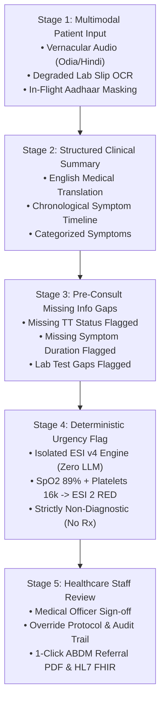

# AROGYA-TRIAGE: Real Working Workflow Demonstration

> **Problem Statement 03 (PS03) Core Mandate**:
> *"A structured triage note generated from messy, multilingual, multimodal patient input → Faster review for the doctor, nurse or medical officer, with missing information surfaced before the consult, not during it → Urgency signals highlighted and queues prioritised without any diagnosis being made → Referral notes for higher facilities prepared in advance instead of scribbled at the door → A demonstrable consent, anonymisation and audit trail that would survive an actual privacy review."*

---

## 5-Stage Live Clinical Workflow Pipeline



---

## Detailed Stage Breakdown (TC-01 Case Study: Sanjib Munda)

### Stage 1: Multimodal Patient Input
- **Facility**: Community Health Center (CHC) Panposh, Rourkela (`FAC-ROU-01`)
- **Patient Pseudonym**: `Sanjib Munda` (Masked token: `REC-TC01-MUNDA`)
- **In-Flight Privacy Masking**:
  - Aadhaar: `9821 4452 1092` ➔ **Masked in memory:** `XXXX-XXXX-1092`
  - Mobile: `9876543210` ➔ **Masked:** `XXXXXX3210`
- **Messy Vernacular Speech (Odia)**:
  > *"ଅତ୍ୟଧିକ ଜ୍ୱର, ମୁଣ୍ଡ ଘୂରାଉଛି, ମାଢ଼ିରୁ ରକ୍ତ ପଡୁଛି (Severe fever, confusion, gum bleeding)"*
- **Degraded Paper Lab Slip OCR**:
  - Platelet Count: `16,000 /uL` (Critical Alert: Normal 150,000–450,000)
  - Haemoglobin (Hb): `11.4 g/dL`
  - Total WBC: `14,200 /uL` (Elevated)
  - Dengue NS1 Ag: `POSITIVE`
- **Triage Vitals**:
  - SpO2: `89%` (Critical Hypoxemia < 90%)
  - Blood Pressure: `88/58 mmHg` (Hypotension / Shock index > 1.0)
  - Pulse: `128 bpm` (Marked Tachycardia)
  - Temperature: `103.4°F` (Severe Pyrexia)
  - Respiration: `26 /min` (Tachypnea)

---

### Stage 2: Structured Clinical Summary
- **Medical English Translation**:
  > *"Patient presents with acute onset high-grade fever, progressive altered mental status (confusion/disorientation), and spontaneous mucosal gingival bleeding over 3 days."*
- **Chronological Symptom Progression Timeline**:
  1. **Day 1**: Acute fever spike with rigors and severe retro-orbital headache.
  2. **Day 2**: Marked lethargy, vomiting, refusal of oral feeds.
  3. **Day 3**: Disorientation, cold clammy extremities, spontaneous gingival bleeding.
- **Categorized Symptoms**: `High-Grade Pyrexia`, `Altered Sensorium`, `Spontaneous Bleed`, `Tachycardia`, `Hypotension`.

---

### Stage 3: Missing Information Gaps (Surfaced Pre-Consult)
*Flagged to the ANM or nurse BEFORE the doctor enters the room, saving 8–10 minutes per consult:*

1. ⚠️ **Tetanus Toxoid (TT) Immunization Status**:
   - *Impact*: Inquire whether open wound or trauma occurred prior to fever spike.
2. ⚠️ **Symptom Duration Marker for Petechiae / Rash**:
   - *Impact*: Tourniquet test or petechial distribution not reported by patient.
3. ⚠️ **Baseline Renal / Creatinine Profile**:
   - *Impact*: Hypotension present (BP 88/58); monitor urine output (< 0.5 mL/kg/h).
4. ⚠️ **Fluid Loss / Oral Intake Assessment**:
   - *Impact*: Immediate volume resuscitation protocol requires oral fluid tolerance check.

---

### Stage 4: Deterministic Urgency Flagging
- **Calculated Urgency Level**: **ESI Level 2 (RED - Emergent / Immediate Bedside Review)**
- **Deterministic Python Rule**:
  ```python
  if spo2 < 90 or platelets < 20000 or (systolic_bp < 90 and pulse > 120):
      urgency = "RED"
      esi_level = 2
  ```
- **Guaranteed Guardrails**:
  - **Zero LLM Hallucination**: Calculated purely via deterministic medical rules.
  - **Zero Drug Prescriptions**: System does NOT prescribe medications, fluids, or dosages.
  - **Zero Final Diagnosis**: Categorized as vital and bleeding derangement, not definitive diagnosis.

---

### Stage 5: Healthcare Staff Review & Sign-Off
1. **Medical Officer Sign-Off**:
   - Reviewer: `Dr. Suchitra Mohanty, MD`
   - Action: 1-Click Approval (`PENDING_REVIEW` ➔ `APPROVED`).
2. **Clinical Override Protocol**:
   - Doctors can adjust ESI level with mandatory textual justification for the DISHA/MCI audit trail.
3. **1-Click ABDM Referral PDF**:
   - Generates print-ready bilingual Referral Note for transfer to SCB Medical College ICU.
4. **HL7 FHIR R4 Bundle**:
   - Export interoperable FHIR JSON bundle containing `Patient`, `Encounter`, `Observation`, and `DiagnosticReport`.

---

## ⚡ 2-Minute Live Evaluation Script (For Judges)

1. Open **http://127.0.0.1:5173** (Command Hub).
2. Point out the interactive **5-Stage Triage Workflow Pipeline** deck on the landing page.
3. Click **"⚡ Launch Real-Time Walkthrough"** (opens Intake Kiosk with TC-01 loaded).
4. Click **"Run Triage Engine (Process Intake)"** (submits the live API call).
5. The screen automatically transitions to the **Doctor Review Dashboard**.
6. Highlight:
   - **ESI Level 2 (RED)** badge.
   - **Missing Information Gaps** in amber.
   - Click **"Approve Triage"** (demonstrates human clinician sign-off).
   - Click **"Download ABDM Referral PDF"** (demonstrates official ABDM transfer note).
